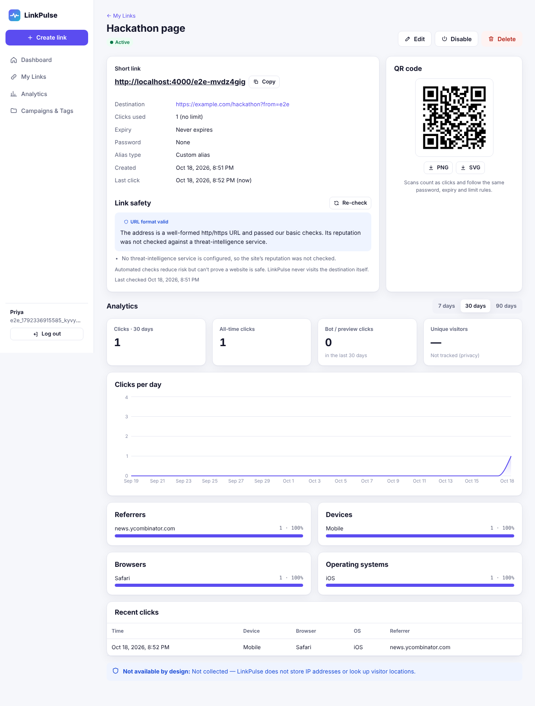
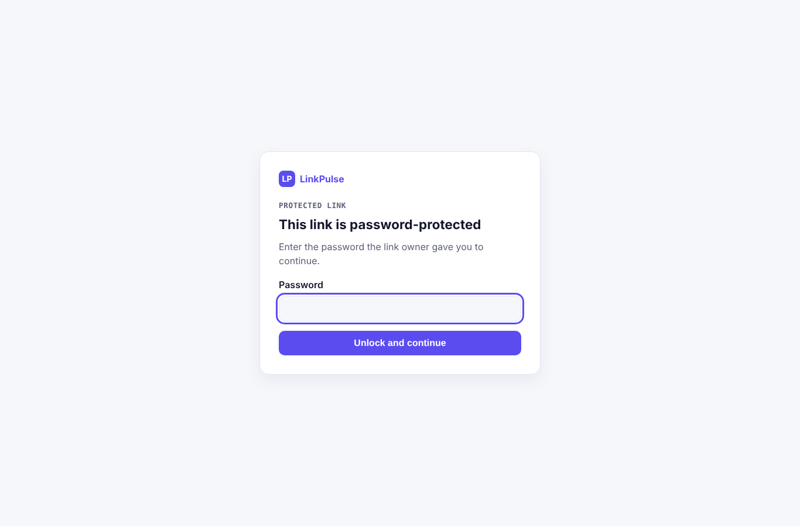
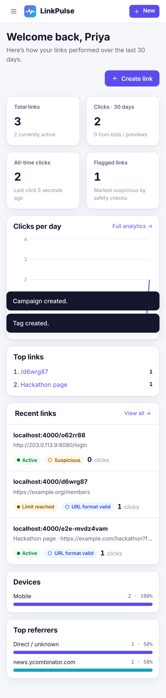

# LinkPulse — Smart Links. Safer Sharing. Clear Insights.

A full-stack URL shortener with real redirects, password / expiry / click-limit rules, honest safety checks, campaigns, tags, QR codes and privacy-light analytics.

- **Frontend**: React 19 + TypeScript + Vite (`web/`)
- **Backend**: Node.js 22 + Express 5 + TypeScript (`server/`)
- **Database**: PostgreSQL 14+ with versioned SQL migrations (`server/migrations/`)
- **Alternative backend**: Supabase Auth + Row Level Security + Edge Functions (`supabase/`, see [docs/SUPABASE.md](docs/SUPABASE.md))

| Doc | What's inside |
|---|---|
| [docs/ARCHITECTURE.md](docs/ARCHITECTURE.md) | Beginner-friendly tour: architecture, schema, request flows, algorithms, security |
| [docs/API.md](docs/API.md) | Every endpoint, request/response shapes, error codes |
| [docs/TEAM_PLAN.md](docs/TEAM_PLAN.md) | Five work areas: tasks, dependencies, file ownership, contracts, test criteria |
| [docs/TESTING.md](docs/TESTING.md) | Automated tests, feature checklist, manual test cases, known limitations |
| [docs/SUPABASE.md](docs/SUPABASE.md) | Supabase options, deployment, what is and isn't tested |

## Screenshots

Captured by the Playwright tests from real data created during the test run.

| Link detail & analytics | Password-protected link | Mobile dashboard |
|---|---|---|
|  |  |  |

## Project structure

```
linkpulse/
├── server/                    Node API (Area 2, 3, 4)
│   ├── migrations/001_init.sql    database schema (versioned)
│   ├── src/
│   │   ├── app.ts                 Express app: security headers, /api, static web, short links
│   │   ├── index.ts               entry point (runs migrations in production)
│   │   ├── config.ts db.ts migrate.ts
│   │   ├── lib/                   auth, shortcode, url validation, safety, user-agent, errors
│   │   ├── middleware/            auth, CSRF origin check, rate limits, error handler
│   │   ├── routes/                auth, links, redirect, analytics, campaigns, tags, safety
│   │   └── views/pages.ts         server-rendered password / warning / error pages
│   └── test/                      vitest + supertest integration & unit tests
├── web/                       React app (Area 1)
│   └── src/  api.ts auth.tsx App.tsx styles.css components/ pages/
├── supabase/                  Supabase-native alternative backend
│   ├── migrations/ functions/{create-link,update-link,r,_shared,tests}/ tests/
├── e2e/                       Playwright journeys (desktop + mobile)
├── docs/                      documentation
├── .env.example  render.yaml  .github/workflows/ci.yml  playwright.config.ts
```

## Run it locally

**Prerequisites**: Node.js 22+, PostgreSQL 14+ (local install, Docker, or a free hosted DB).

```bash
# 1. Database (pick one)
createdb linkpulse && createdb linkpulse_test                       # local Postgres
# or: docker run -d --name lp-pg -e POSTGRES_PASSWORD=postgres -p 5432:5432 postgres:16
#     then: docker exec lp-pg createdb -U postgres linkpulse && docker exec lp-pg createdb -U postgres linkpulse_test

# 2. Install & configure
npm install
cp .env.example server/.env          # edit DATABASE_URL if needed

# 3. Create tables
npm run migrate

# 4. Start API (:4000) and web app (:5173) together
npm run dev
```

Open **http://localhost:5173**, sign up, create a link. Short links look like `http://localhost:4000/abc1234` (the API serves redirects). Vite proxies `/api` to the API so the session cookie works in development.

### Production build locally

```bash
npm run build                                   # builds web/dist and server/dist
NODE_ENV=production COOKIE_SECURE=false SHORT_BASE_URL=http://localhost:4000 APP_ORIGIN=http://localhost:4000 npm start
# → http://localhost:4000 serves the app, the API and the short links on one origin
```

## Tests

```bash
npm run typecheck
npm test                                         # needs the linkpulse_test database
./supabase/tests/run.sh                          # Supabase SQL/RLS (+ Deno function tests if Deno is installed)
npm run build && <start production server as above> && npx playwright install chromium && npm run e2e
```

See [docs/TESTING.md](docs/TESTING.md) for results, the feature checklist and 25 manual test cases.

## Deploy for free

The app is a single Node web service plus a PostgreSQL database. Free tiers change often — check each provider's current limits.

**Database** (any one): [Neon](https://neon.tech), [Supabase](https://supabase.com) (Postgres only — see SUPABASE.md Option A), or Render Postgres. Copy the connection string; set `DATABASE_SSL=true` for Neon/Supabase.

**Web service** — Render (blueprint included):

1. Push this repo to GitHub.
2. Render → **New → Blueprint** → select the repo (uses `render.yaml`: free web service + free Postgres).
3. After the first deploy, set `SHORT_BASE_URL` and `APP_ORIGIN` to your `https://<name>.onrender.com` URL and redeploy.
4. Migrations run automatically on start. Visit `/api/health` → `{"ok":true}`.
5. Smoke-test journeys 1–10 from docs/TESTING.md on the live URL.

**Any other Node host** (Railway, Fly.io, Koyeb, a VPS):

| Setting | Value |
|---|---|
| Build command | `npm ci --include=dev && npm run build` |
| Start command | `npm start` |
| Env | `NODE_ENV=production`, `DATABASE_URL`, `DATABASE_SSL`, `SHORT_BASE_URL=https://your.domain`, `APP_ORIGIN=https://your.domain`, `TRUST_PROXY=1` |
| Health check | `/api/health` |

Free instances that sleep make the first redirect after idle slow (cold start). A short custom domain makes links nicer: point it at the host and update `SHORT_BASE_URL`/`APP_ORIGIN`.

### Optional: threat intelligence

Create a Google Cloud API key with the **Safe Browsing API** enabled and set `GOOGLE_SAFE_BROWSING_API_KEY`. Links then get “No known issue found” when Google has no match. Without a key they're labelled “URL format valid” (reputation not checked) — the app never claims a link is safe.

### Blocklist

Comma-separated in `BLOCKLIST_DOMAINS`, or rows in the DB:

```sql
INSERT INTO blocked_domains (domain, reason) VALUES ('bad.example', 'phishing report #12');
```

Blocklisted domains (and their subdomains) are refused at creation **and** at redirect time, so adding a domain disables existing links to it immediately.

## Debugging

| Symptom | Check |
|---|---|
| `ECONNREFUSED 5432` | Postgres isn't running or `DATABASE_URL` is wrong |
| `relation "users" does not exist` | Run `npm run migrate` |
| Hosted DB: `no pg_hba.conf entry` / TLS error | Set `DATABASE_SSL=true` |
| Logged in but every API call is 401 in production | Site must be HTTPS when `COOKIE_SECURE=true`; for local prod testing set `COOKIE_SECURE=false` |
| `403 Request origin not allowed` | `APP_ORIGIN` must exactly match the URL in the browser (scheme + host + port) |
| Rate limit hits everyone at once behind a proxy | Set `TRUST_PROXY=1` so the real client IP is used |
| Short links point at localhost in production | Set `SHORT_BASE_URL` to your public URL |
| Server error 500 | The server logs the full error (`[METHOD /path] …`); the client only sees a generic message |
| Inspect data | `psql $DATABASE_URL -c 'SELECT code, click_count, status FROM links ORDER BY created_at DESC LIMIT 10'` |

## Security notes

No secrets are in the code. Passwords (accounts and links) are bcrypt hashes; session tokens are stored hashed; the browser never sees a database URL or service key. See the security table in [docs/ARCHITECTURE.md](docs/ARCHITECTURE.md#security-checklist-what-protects-what).

## Email, scaling and shared code (quick notes)

- **Verification + password reset** work out of the box in development (emails are printed to the server log). In production set `EMAIL_PROVIDER=resend` (+ `RESEND_API_KEY`) or `smtp` (+ `SMTP_HOST/PORT/USER/PASS`), and `EMAIL_FROM`. Sign-up then becomes private (it never reveals which emails are registered) and unverified accounts can't create links (`PRIVATE_SIGNUP`, `REQUIRE_EMAIL_VERIFICATION`).
- **Several instances?** Rate limits are shared through PostgreSQL by default; nothing else to configure.
- **Editing code used by both backends?** Change it in `shared/`, then run `npm run sync` (CI fails if you forget).
- Apply the new database migration with `npm run migrate` (it also runs on start in production).
